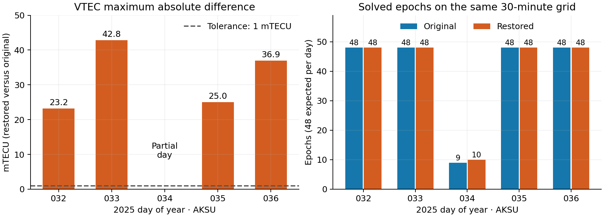
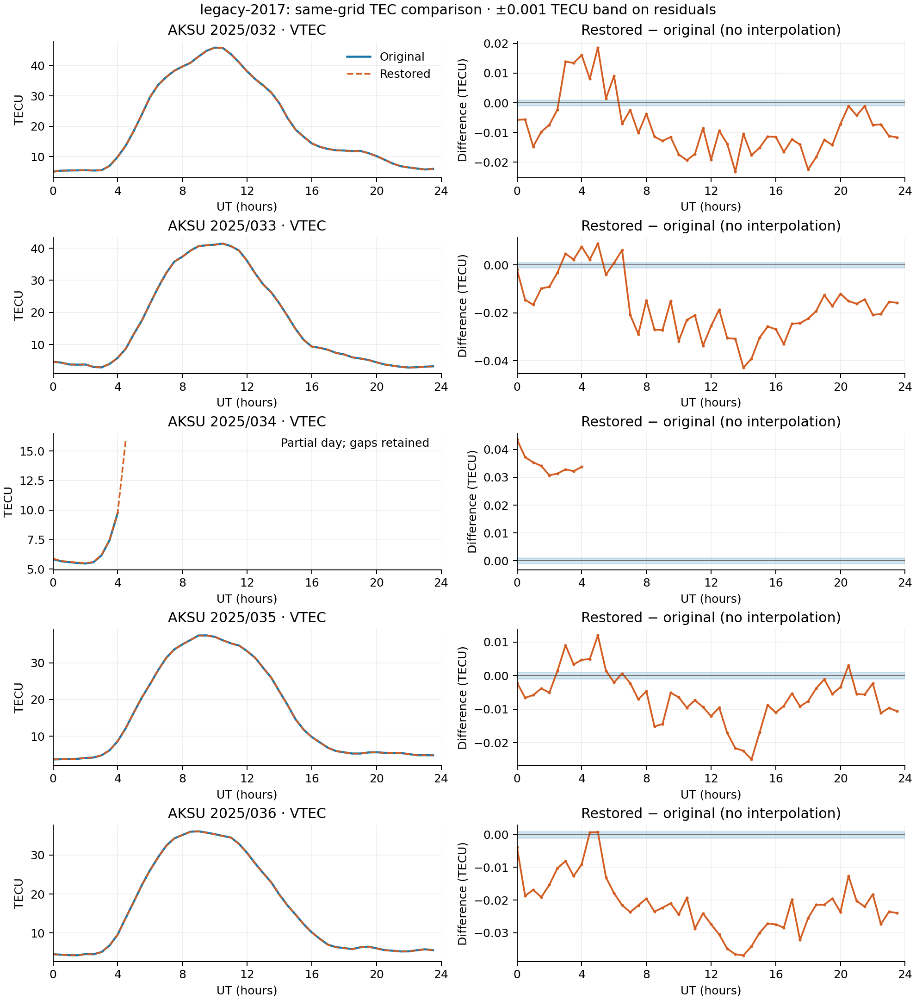
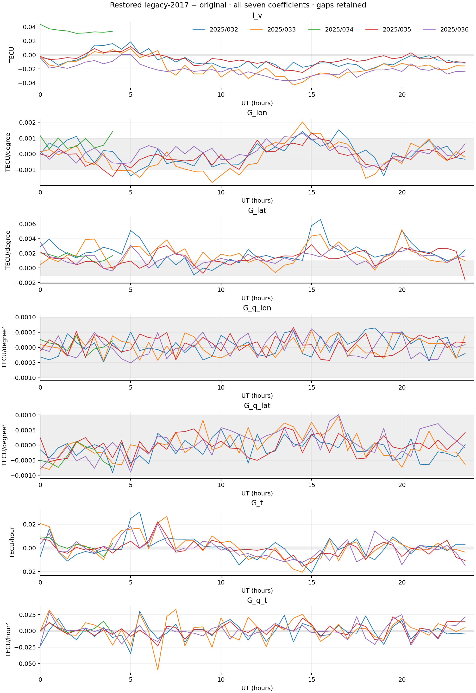
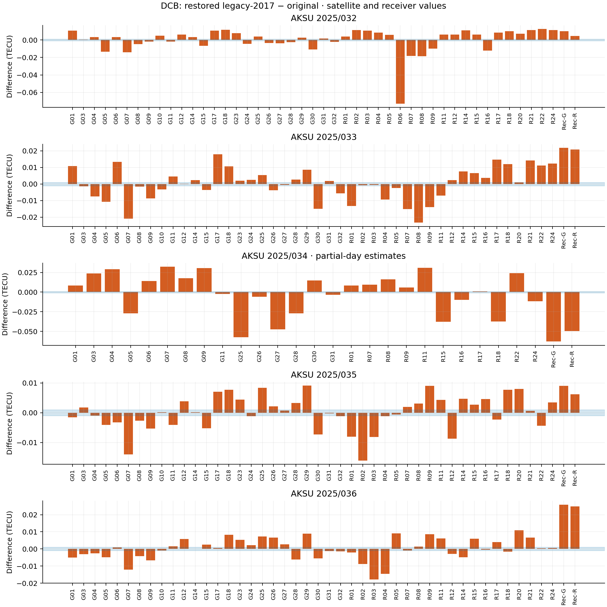
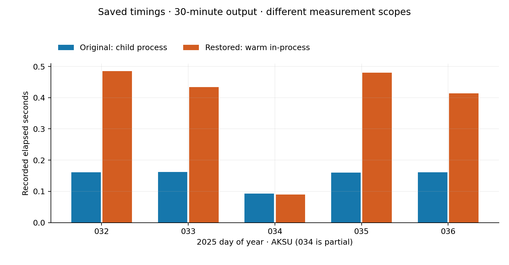
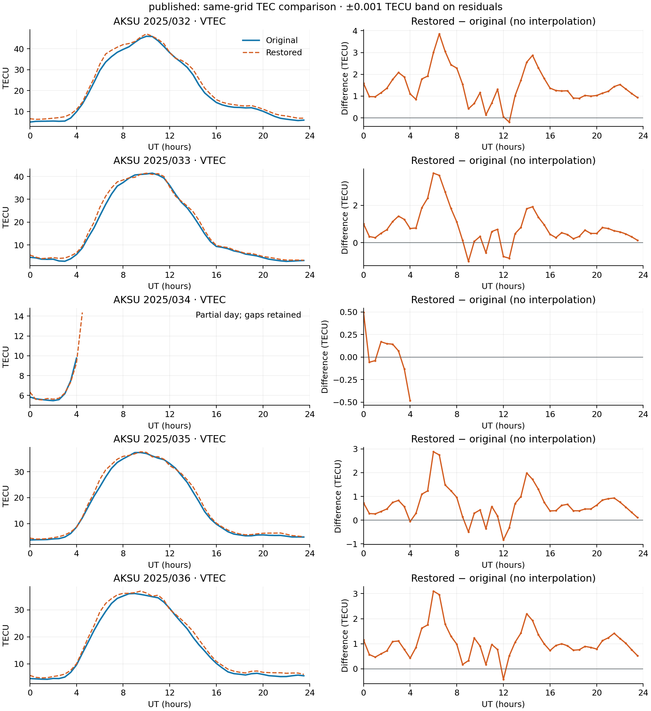

# Restored versus original AbsolTEC

AKSU · 2025/032–036 · existing validation evidence from 17 November 2026.

**Result: strict numerical compatibility fails.** The restored `legacy-2017` mode follows the recovered legacy behavior; `published` is an alternative scientific model and is reported separately. Neither is certified against external ionospheric truth.

## Same-grid comparison

Both engines used identical GPS/GLONASS DAT inputs, a 30-minute output grid, 10° elevation cutoff, and correction coefficient 0.97. All seven coefficients and DCB values were compared without interpolation or fitted offsets. Differences below are restored minus original.

| Day | Original solved | Restored solved | VTEC RMSE (TECU) | VTEC max difference (TECU) | DCB max difference (TECU) | Strict result |
| --- | ---: | ---: | ---: | ---: | ---: | --- |
| 032 | 48/48 | 48/48 | 0.012558 | 0.023203 | 0.072976 | FAIL |
| 033 | 48/48 | 48/48 | 0.021180 | 0.042842 | 0.023296 | FAIL |
| 034 | 9/48 | 10/48 | 0.034772 (partial) | 0.043592 | 0.062963 | FAIL |
| 035 | 48/48 | 48/48 | 0.009759 | 0.025018 | 0.015995 | FAIL |
| 036 | 48/48 | 48/48 | 0.022865 | 0.036923 | 0.025915 | FAIL |

The sparse day 034 has different coverage (9 original versus 10 restored epochs); its descriptive TEC errors use only shared finite epochs and cannot establish full-day agreement. Original all-zero coefficient rows are treated as missing placeholders. Native NaN gaps are retained. No gaps are interpolated. Strict tolerance is 0.001 absolute and zero relative tolerance, applied separately to each coefficient's own units and to DCB values; it is not a validated physical-accuracy requirement.

## TEC traces

The original and restored curves nearly overlap on complete days; the residual panels show the remaining differences.

## All seven coefficients

## Satellite and receiver biases

DCB values are compared by identity, including per-constellation receiver values. Their separation uses the reporting convention described in the implementation notes; this is not validation against an external hardware-bias catalogue.

## Timing and stability

The current saved timings do not demonstrate a speed improvement. They are single-run observations with different measurement scopes: original child-process lifetime includes process startup and I/O; native timing includes parsing, fitting and output writing in a process with Python/NumPy/SciPy already loaded. Both exclude input/executable copying. Day 034 is incomplete. These are not repeated, controlled benchmarks; no speedup, peak-memory, or long-run reliability claim is established. The saved original processes exited zero on these five cases, including the incomplete day. The production XP failures are a separate operating environment.

## Alternative published model

This mode changes geometry, screening and time conventions. Its differences from the original are expected model differences, not a compatibility result.

## Data and reproducibility

- [Day summaries](summary.csv), [coefficient statistics](coefficients.csv), [epoch observations](observations.csv), [DCB records](dcb.csv), and [saved timings](timings.csv). Blank CSV values mean missing evidence, not zero.
- [Comparison metadata](comparison.json) records SHA-256 hashes of the source report, archive, and every extracted TEC/DCB file. Each extracted file was checked against the saved validation identity before plotting.
- Raw half-hour outputs are under `data/`; both native modes and original results are included. All native fine-grid timings are retained in the timing CSV, but no fine-grid original reference was run.
- Complete-day coefficient errors were independently recomputed and checked against the saved validation report. The original executable was not rerun for this report.
- These inputs were derived using a documented RINEX version-header adaptation, not a certified conversion. Only one station and five days are covered. Adjacent-day observations were not loaded. External physical accuracy and production robustness remain unverified.
- [Original validation report](../absoltec_science_validation.json), [input provenance](../absoltec_input_provenance.json), [run manifest](../absoltec_science_manifest.json), and [implementation notes](../absoltec_reconstruction.md).

Rebuild into a new directory with `python scripts/report_absoltec_comparison.py --output docs/absoltec_comparison_new`.
