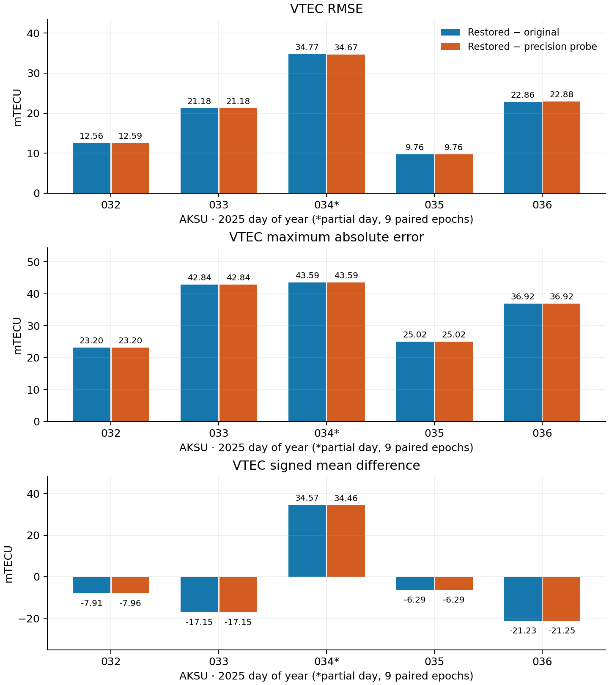
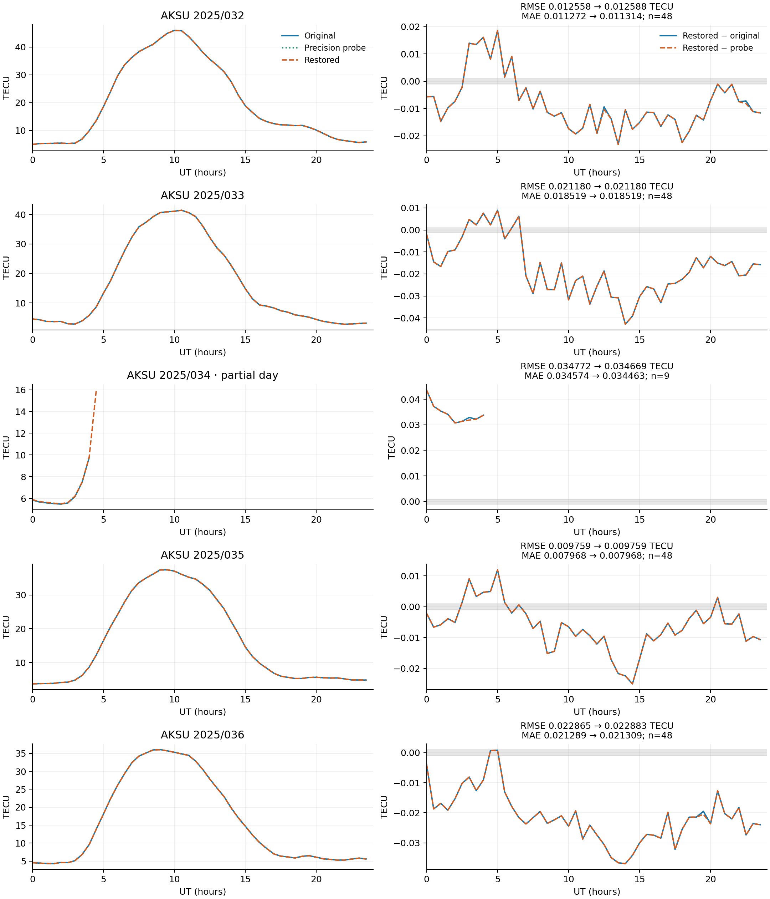
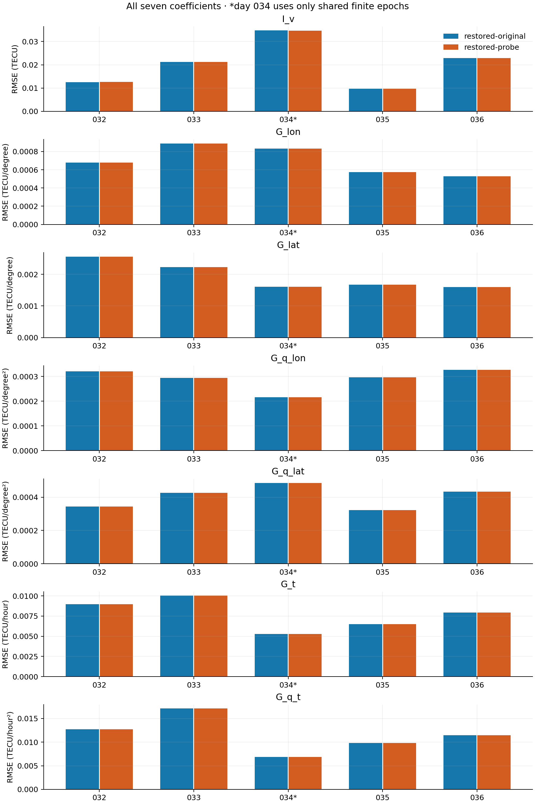

# Round 2 graphics and metrics

Comparison of the unchanged original, the isolated precision probe, and restored legacy-2017 model. AKSU 2025/032–036, 30-minute grid. Saved evidence only; no new engine runs.

## Metric definitions and limits

Differences are candidate minus reference. RMSE, MAE, signed bias, maximum absolute difference, Pearson correlation, and agreement R² are provided for all seven coefficients in [metrics.csv](metrics.csv) and [metrics.json](metrics.json). Agreement R² = 1 − sum(error²)/sum((reference − reference mean)²); it is not squared correlation. High correlation does not establish numerical parity.

The tolerance count uses 0.001 in each coefficient's units with a 1e-12 floating-point boundary allowance. Full-day acceptance also requires complete coverage. Day 034 metrics use only nine paired finite epochs; missing samples are never filled or interpolated. The plotted residual band is ±0.001 TECU. The probe is an experimental binary, not an approved replacement. All input output-file hashes were verified against saved manifests.

The original prints only three decimal places. Probe differences below that resolution cannot be inferred from these files. No external physical accuracy or speed improvement is established.

[Round 2 investigation](../REPORT.md)
