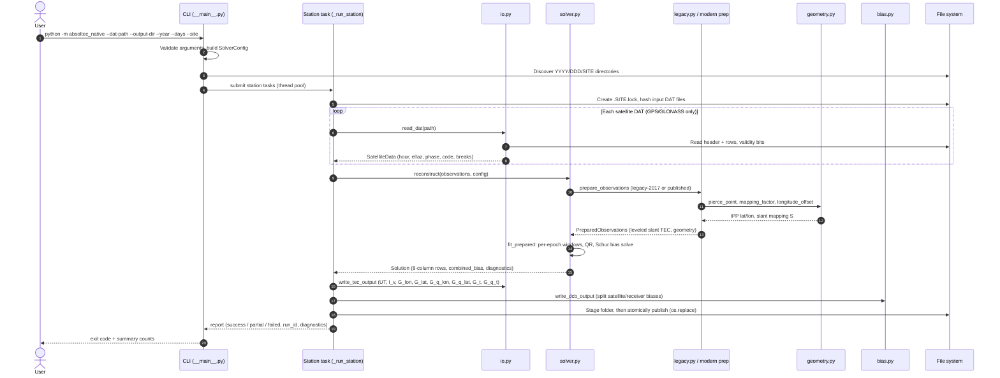
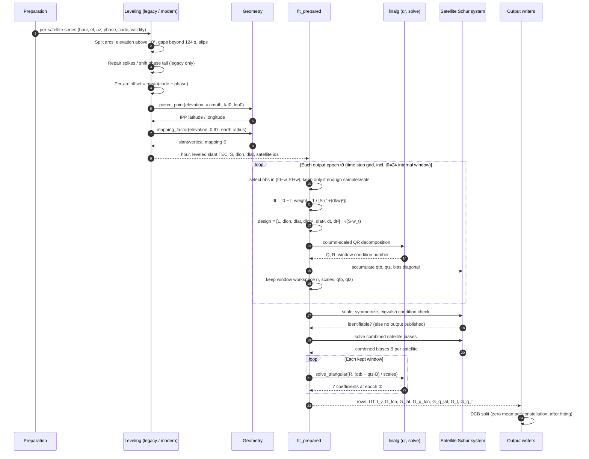

# AbsolTEC reconstruction — sequence diagrams

These diagrams cover the native AbsolTEC reconstruction
(`absoltec_native/`), the experimental replacement for the 2017
`absolTEC.exe`. The scientific pipeline was recovered with REA/Ghidra; the
full evidence is in [absoltec_reconstruction.md](absoltec_reconstruction.md).
Numeric parity with the original is not yet established.

1. [Batch run](#1-batch-run-cli-station-task-and-publishing): one CLI call,
   many station-days, transactional output folders.
2. [The calculation algorithm](#2-the-calculation-algorithm-leveling-and-the-seven-coefficient-fit):
   phase leveling, IPP geometry, and the windowed weighted least-squares fit.

The diagrams are Mermaid, so GitHub draws them in place. Step numbers in the
text refer to the numbers on the arrows.

## 1. Batch run: CLI, station task and publishing

### What it shows

`python -m absoltec_native --dat-path … --output-dir … --year 2025 --days 032-036`
discovers `ROOT/YYYY/DDD/SITE` directories, runs each station-day as an
independent task (thread pool, one lock per station), and publishes outputs
only after the whole station folder is staged. A failed task never replaces a
previous good result.

### Participants

| Participant | Code | Role |
|---|---|---|
| CLI | `absoltec_native/__main__.py` | Argument checks, day/site discovery, thread pool |
| Station task | `_run_station` in `__main__.py` | Lock, input identity, per-station transaction |
| IO | `absoltec_native/io.py` | `read_dat` parses tec-suite DAT, `write_tec_output` publishes 8 columns |
| Solver | `absoltec_native/solver.py` | `prepare_observations` + `fit_prepared` |
| Preparation | `absoltec_native/legacy.py` or `_prepare_modern` | Arc screening, repairs, phase leveling |
| Geometry | `absoltec_native/geometry.py` | Piercing point, slant mapping, longitude offset |
| Bias writer | `absoltec_native/bias.py` | Zero-mean split of combined biases, DCB DAT |
| Filesystem | input/output roots | Satellite DATs in, staged and published folders out |



### Walkthrough

- **Steps 1–3, discovery.** The CLI validates ranges (year, day list, time
  step, window, cutoffs) and walks `ROOT/YYYY/DDD/` for station directories.
  A day with no stations produces a recorded failure, not a silent skip.
- **Steps 4–8, guarded input.** `_run_station` takes an exclusive lock, hashes
  each input, rejects unsupported constellations (only `G*`/`R*` are fitted),
  and re-hashes after reading so a file changing mid-run aborts the task.
  `read_dat` keeps validity bits, slip flags and gaps instead of trusting a
  zero placeholder.
- **Steps 9–12, solve.** `reconstruct` picks the preparation path:
  `--model legacy-2017` replays the recovered 2017 screening (30-second
  selection, 1999-row cap, scalar spike/phase repairs), `--model published`
  uses validity-aware arcs. Both level phase TEC against code TEC per
  continuous arc and add IPP geometry.
- **Steps 13–15, publish.** Outputs are written into a staging directory and
  only then moved into place; with `--overwrite` the previous folder is
  renamed first and restored if the move fails. Unsolved windows are NaN rows,
  so a partial day is visible instead of invented zeros.
- **Step 16–17.** Each task returns a structured report (`status`, run id,
  input hashes, diagnostics, timings); the CLI prints progress and returns a
  failing exit code when any station is partial or failed.

### Why it is built this way

- **Inputs are treated as untrusted.** The legacy binary is not invoked at
  all; nothing under the input root can select paths outside it.
- **One lock per station.** Independent stations can run in parallel
  (`--jobs`), but two processes never publish the same station folder.
- **Nothing half-written is visible.** Consumers see either the old result or
  the complete new folder, never a mix.

## 2. The calculation algorithm: leveling and the seven-coefficient fit

### What it shows

The recovered mathematical core. For every output epoch the original (and
this reconstruction) fits the slant model

```text
slant_TEC = S * [V + G_lon*dlon + G_lat*dlat + Q_lon*dlon^2
                 + Q_lat*dlat^2 + G_t*dt + Q_t*dt^2] + B_satellite
```

over a strict ±1-hour window: seven local coefficients `V, G_lon, G_lat,
Q_lon, Q_lat, G_t, Q_t` plus one combined satellite bias per link. The local
coefficients are QR-eliminated per window; only the satellite-sized Schur
system is solved globally, then coefficients are recovered by back
substitution.

### Participants

| Participant | Code | Role |
|---|---|---|
| Preparation | `solver.py:prepare_observations` | Dispatch to legacy or modern screening |
| Leveling | `legacy.py` / `_prepare_modern` | Arc detection, repairs, phase-to-code offset |
| Geometry | `geometry.py` | `pierce_point`, `mapping_factor`, `longitude_offset` |
| Fit | `solver.py:fit_prepared` | Window loop, weighting, design build |
| QR | `scipy.linalg` | `qr`, `solve_triangular`, `svdvals`, `eigvalsh` |
| Schur | `solver.py` accumulation | Satellite bias system (`qtz`, `qtb`, `gram`) |
| Output | `io.py`, `bias.py` | 8-column DAT, DCB DAT/JSON |



### Walkthrough

- **Steps 1–4, arcs and leveling.** Arcs are continuous phase spans above 10°
  elevation (a gap over 124 s splits them; the legacy path also tolerates
  short invalid spans and repairs spikes with 4σ / 5-TECU thresholds). Each
  arc gets one additive offset that levels phase TEC onto code TEC; missing
  code does not split a phase arc in the published path.
- **Steps 5–7, geometry.** The pierce point is computed on the spherical shell
  (6371 km / 450 km; the recovered 2017 mapping literally uses 6371302.0 m
  and an asin longitude that loses the polar quadrant). `dlon`/`dlat` are
  offsets from the station, with a dateline-safe longitude difference.
- **Steps 8–15, window loop.** Each output epoch builds a strict ±1 h window
  (the legacy code excludes the edges), applies the recovered slant weight
  `1/[S·(1+dt²)]`, column-scales the seven-term design, and QR-eliminates the
  local coefficients. Only the satellite-sized Schur complement is
  accumulated — memory grows with observations and satellites, not with the
  square of all daily parameters.
- **Steps 16–19, bias solve.** The Schur system is scaled and symmetrized;
  if its eigenspectrum shows rank loss or ill-conditioning, the day fails
  loudly instead of publishing biased output.
- **Steps 20–23, back substitution and output.** Each window's coefficients
  are recovered from its stored triangular factor, the 24-hour internal window
  is dropped from the reported day, and the eight columns are written.
  Combined biases are split into satellite and receiver parts only for
  reporting, with a per-constellation zero mean — this does not constrain the
  fit itself.

### Why it is built this way

- **The fit is a Schur elimination, not a dense day matrix.** The 2017 binary
  built a dense normal system (the `.data` virtual size of ~1.37 GB in a
  32-bit image matches its memory failures). This reconstruction keeps the
  same mathematics in bounded memory.
- **Weighting and windows are recovered, not invented.** The strict window,
  the `dt` convention, and the slant weight come from the disassembled
  instructions; the published model uses forward time, the legacy model
  backward.
- **Precision loss is a known difference.** The old solver rounded
  double→single→double inside its matrix routines (`cvtsd2ss`/`cvtss2sd`);
  the reconstruction keeps double precision, which is one of the identified
  causes of the remaining numeric differences.
