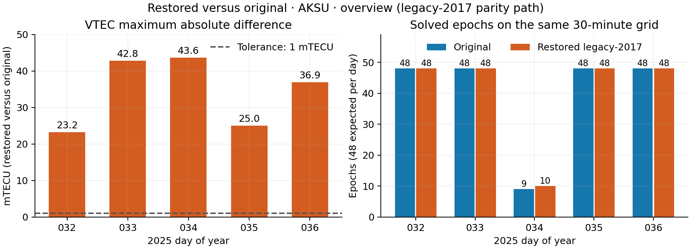
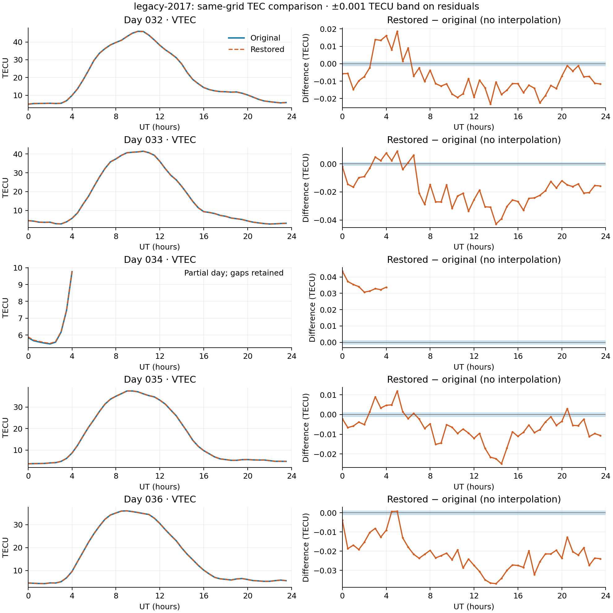
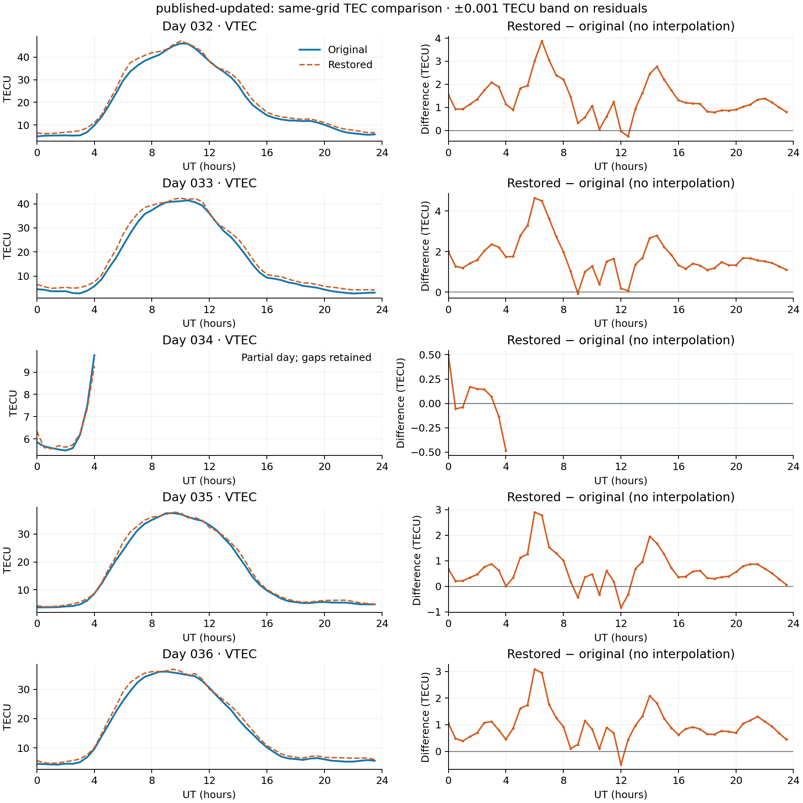
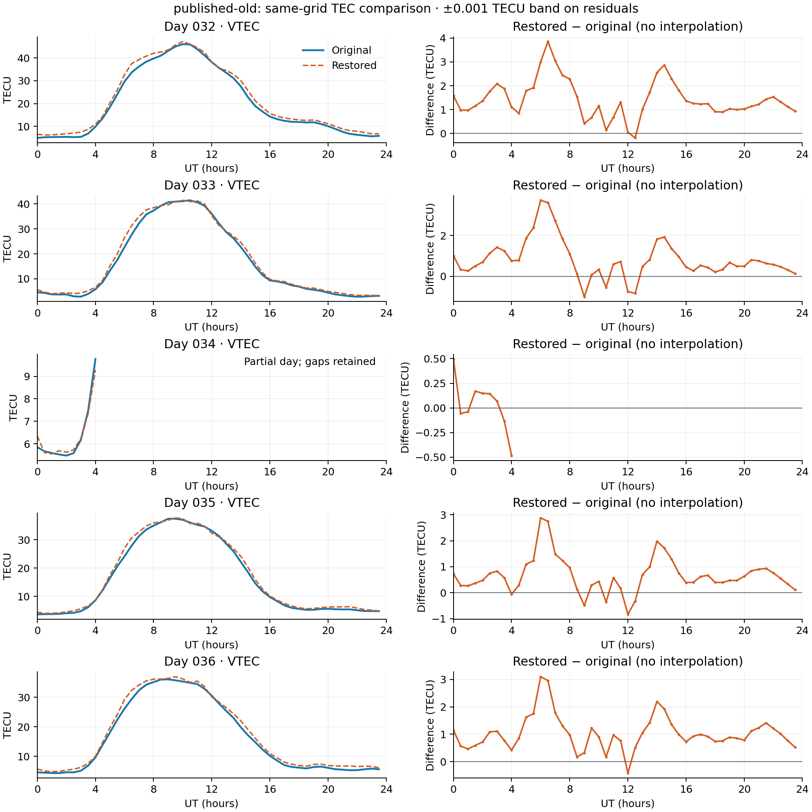
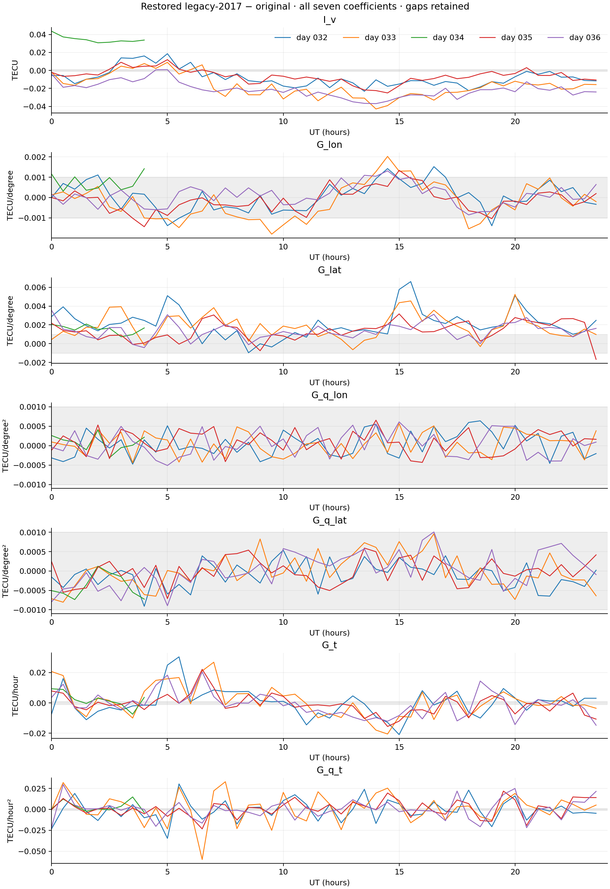
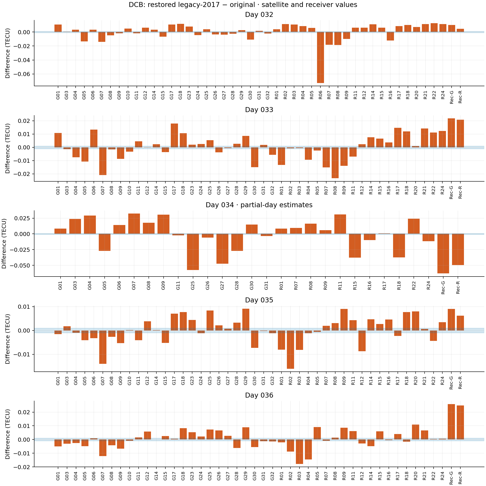

# Updated AbsolTEC versus original — metrics

AKSU · 2025/032–036 · 30-minute grid · generated 2026-11-17T21:56:11.895838+00:00.

Differences are restored minus original, in TECU, on exactly shared epochs.
Day 034 is partial in both engines. Original all-zero coefficient rows are missing placeholders.

## Same-grid comparison

| Day | Model | Shared epochs | VTEC RMSE | VTEC MAE | VTEC bias | VTEC max abs | VTEC corr | VTEC R² | DCB max abs |
| --- | --- | ---: | ---: | ---: | ---: | ---: | ---: | ---: | ---: |
| 032 | legacy-2017 | 48 | 0.012558 | 0.011272 | -0.007913 | 0.023203 | 0.999999786 | 0.999999228 | 0.072976 |
| 032 | published-updated | 48 | 1.586501 | 1.380661 | +1.368746 | 3.873461 | 0.998433489 | 0.987750056 | 6.923154 |
| 032 | published-old | 48 | 1.632283 | 1.440140 | +1.432161 | 3.855180 | 0.998507221 | 0.987032223 | 6.673326 |
| 033 | legacy-2017 | 48 | 0.021180 | 0.018519 | -0.017145 | 0.042842 | 0.999999676 | 0.999997794 | 0.023296 |
| 033 | published-updated | 48 | 1.959207 | 1.722954 | +1.720111 | 4.635535 | 0.997837820 | 0.981127634 | 6.756399 |
| 033 | published-old | 48 | 1.245201 | 0.944497 | +0.814811 | 3.722090 | 0.997821052 | 0.992378064 | 6.766711 |
| 034 | legacy-2017 | 9 | 0.034772 | 0.034574 | +0.034574 | 0.043592 | 0.999996258 | 0.999330538 | 0.062963 |
| 034 | published-updated | 9 | 0.253234 | 0.192987 | +0.034782 | 0.494948 | 0.990807968 | 0.952282876 | 7.224342 |
| 034 | published-old | 9 | 0.253234 | 0.192987 | +0.034782 | 0.494948 | 0.990807968 | 0.952282876 | 7.100416 |
| 035 | legacy-2017 | 48 | 0.009759 | 0.007968 | -0.006287 | 0.025018 | 0.999999844 | 0.999999407 | 0.015995 |
| 035 | published-updated | 48 | 0.954764 | 0.739869 | +0.660329 | 2.906701 | 0.998537057 | 0.994379361 | 6.390419 |
| 035 | published-old | 48 | 0.958217 | 0.754115 | +0.668125 | 2.879194 | 0.998537337 | 0.994310628 | 6.266022 |
| 036 | legacy-2017 | 48 | 0.022865 | 0.021289 | -0.021228 | 0.036923 | 0.999999766 | 0.999996371 | 0.025915 |
| 036 | published-updated | 48 | 1.154902 | 0.988088 | +0.967364 | 3.084430 | 0.998652608 | 0.990872360 | 6.165449 |
| 036 | published-old | 48 | 1.209305 | 1.053600 | +1.036165 | 3.101452 | 0.998681600 | 0.989985265 | 6.008256 |

## TEC traces

The original and restored curves nearly overlap on complete days for the parity path; the residual panels show the remaining differences.

## All seven coefficients

## Satellite and receiver biases

DCB values are compared by identity, including per-constellation receiver values.

- [Per-coefficient metrics](metrics.csv) · [day summaries](summary.csv) · [DCB records](dcb.csv) · [metadata](comparison.json)

Strict 0.001 TECU parity tolerance is a separate, stricter question; these are descriptive metrics.
