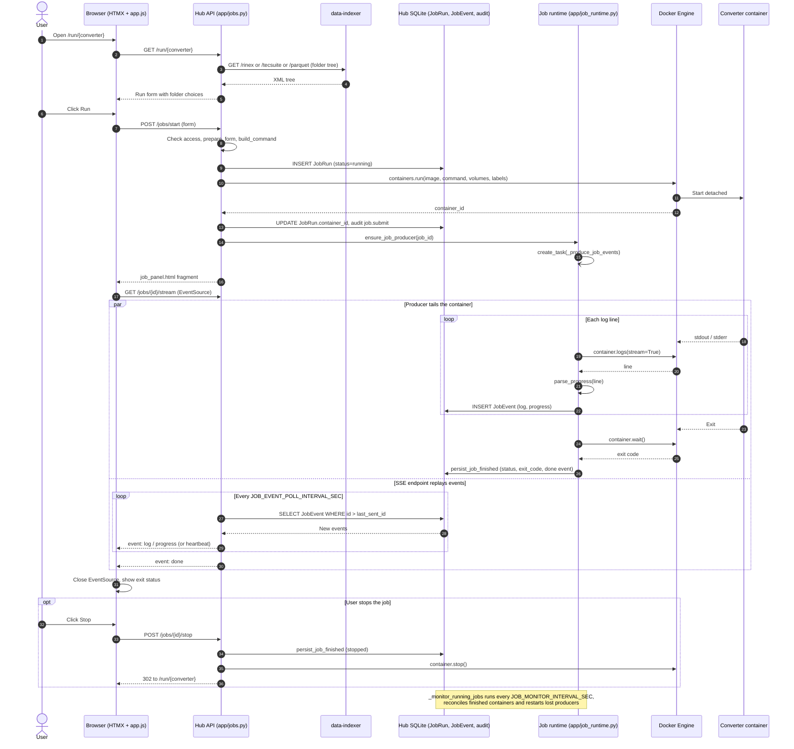
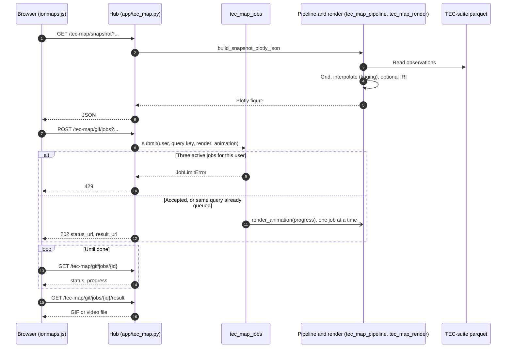

# Sequence diagrams

ConverterHub is two services: the hub (`app/`), which serves the web UI and runs
jobs, and the data-indexer (`data-indexer/`), which lists the data on disk. The
three flows below cover most of what they do together:

1. [Converter job](#1-converter-job-start-live-log-stop): start a container,
   stream its log, stop it.
2. [Data browsing](#2-data-browsing-through-the-data-indexer): fill the run
   forms and data pages with folder trees.
3. [TEC map](#3-tec-map-snapshot-and-animation): render a single map or a
   long animation.

The diagrams are Mermaid, so GitHub draws them in place. Step numbers in the
text refer to the numbers on the arrows.

## 1. Converter job: start, live log, stop

### What it shows

A user picks a converter (TEC-Suite, AbsTEC, DAT to Parquet), fills the form and
watches the container's log and progress bar live. The browser never reads the
container directly. A background producer copies the log into the database, and
the browser's stream reads it back from there.

### Participants

| Participant | Code | Role |
|---|---|---|
| Browser | `templates/run.html`, `static/app.js` | HTMX form, `EventSource` on the stream |
| Hub API | `app/jobs.py` | Validates, starts the container, serves the stream |
| data-indexer | `data-indexer/app.py` | Lists the folders the form offers |
| Hub SQLite | `app/models.py` | `JobRun` row per job, `JobEvent` row per log line, audit log |
| Job runtime | `app/job_runtime.py` | One producer task per running job, plus a monitor loop |
| Docker Engine | `app/runner.py` | Docker SDK through the mounted socket |
| Converter | registry image | The container that does the work |



### Walkthrough

- **Steps 1–5, the form.** The run page asks the data-indexer for the folder
  tree of the converter's input (RINEX years and days for TEC-Suite, TEC-Suite
  output for AbsTEC, and so on), so the user picks folders instead of typing
  paths.
- **Steps 6–8, validation.** `start_job` checks that the user may run this
  converter, then `prepare_form` (`app/converters.py`) validates the fields and
  fills in the server-side data paths. `build_command` (`app/registry.py`) turns
  the form into the container's command line and volume mounts.
- **Step 9, record first.** The `JobRun` row is written before the container
  starts, so a failed start still leaves an audit trail. A Docker error marks
  the job `error` with exit code `-1`.
- **Steps 10–13, start.** The container runs detached with labels
  `ict-hub.job_id`, `ict-hub.user_id` and `ict-hub.converter`, so it can be
  traced back to its job from `docker ps`.
- **Steps 14–16, hand over.** The hub starts at most one producer task per job
  and returns the job panel fragment, which HTMX swaps into the page. `app.js`
  then opens an `EventSource` on the stream (step 17).
- **The producer (left branch of `par`).** It follows the container's log,
  extracts a 0–100 progress figure from each line with the converter's
  `progress_patterns`, and stores every line and every progress increase as a
  `JobEvent`. Progress only ever moves forward. When the container exits it
  stores the exit code, the final status and a `done` event. Old log events
  are pruned to the last `JOB_EVENT_LOG_MAX_LINES`.
- **The stream (right branch of `par`).** The SSE endpoint polls `JobEvent` for
  rows newer than the last one it sent (every `JOB_EVENT_POLL_INTERVAL_SEC`,
  0.5 s by default) and sends a heartbeat comment every
  `SSE_HEARTBEAT_INTERVAL` (15 s) when nothing happens. It ends after `done`.
- **Stop.** The stop is recorded before `docker stop` runs, because the
  container's exit reaches the producer before the stop call returns, and the
  job must read as stopped, not failed.

### Why it is built this way

- **Durable events make the stream resumable.** The producer writes to the
  database whether or not anyone is watching. A browser that reconnects sends
  `Last-Event-ID` (or `after_event_id`) and gets exactly the events it missed.
  `?tail=N` replays only the last N lines. A page opened after the job finished
  still gets the full log and the `done` event.
- **Nothing depends on the browser staying open.** Closing the tab does not stop
  the job or lose its log.
- **The monitor loop is the safety net.** Every `JOB_MONITOR_INTERVAL_SEC` (3 s)
  it checks each running job against Docker. It finishes jobs whose containers
  exited while no producer was attached, for example after a hub restart, and
  restarts producers that died.
- **There is a fallback.** If a running job has produced no stored events within
  `JOB_EVENT_BOOTSTRAP_TIMEOUT_SEC` (1.5 s), the stream reads the container log
  directly instead of waiting.

## 2. Data browsing through the data-indexer

### What it shows

How the hub gets the folder trees for the run forms, the Indexed data page, the
Stations map and the Analysis page. Walking a RINEX archive takes minutes, so
both sides cache, and the indexer answers from its cache whenever it can.

### Participants

| Participant | Code | Role |
|---|---|---|
| Hub client | `app/data_indexer_client.py` | HTTP client, parses XML, caches for `DATA_INDEXER_CLIENT_CACHE_TTL_SEC` (30 s) |
| data-indexer | `data-indexer/app.py` | FastAPI endpoints `/rinex`, `/rinex-stations`, `/tecsuite`, `/abstec`, `/parquet`, `/parquet-satellites` |
| Memory cache | `data-indexer/data_indexer.py` | One dictionary per data type, keyed by root path |
| SQLite cache.db | `data-indexer/data_indexer.py` | Persistent copy of the memory cache |
| Data volumes | docker-compose mounts | RINEX, TEC-Suite, AbsTEC and parquet folders, read-only |

```mermaid
sequenceDiagram
    autonumber
    participant Hub as Hub (data_indexer_client.py)
    participant Idx as data-indexer (app.py)
    participant Mem as Indexer memory cache
    participant Cache as Indexer SQLite cache.db
    participant FS as Data volumes (RINEX, TEC-suite, AbsTEC, parquet)

    Note over Idx,Cache: Startup: _load_cache_from_db fills memory;<br/>optional warm index in a thread if should_run_full_index()

    Hub->>Hub: _get_cache(endpoint, root)
    alt Hub cache fresh
        Hub->>Hub: Return cached tree
    else Hub cache miss or expired
        Hub->>Idx: GET /{endpoint}?root=...
        Idx->>Idx: Check root lies inside a configured data path
        Idx->>Idx: _ensure_watcher(root)
        alt refresh=true or watcher saw a change
            Idx->>FS: Scan now
            Idx->>Mem: Store
            Idx->>Cache: Store
        else Fresh (age < TTL)
            Idx->>Mem: Read
        else Stale
            Idx->>Mem: Read old result
            Idx-)FS: Background thread rescans
            Idx-)Cache: Store new result
        else Missing
            Idx->>FS: Scan now
            Idx->>Mem: Store
            Idx->>Cache: Store
        end
        Idx-->>Hub: XML
        Hub->>Hub: Parse XML, _set_cache
    end
```

### Walkthrough

- **Startup.** The indexer loads `cache.db` into memory, so a restart serves the
  last known trees at once. With `DATA_INDEXER_RUN_ON_STARTUP=true` or `async`
  it also re-indexes every data type in a background thread, but only when the
  last full pass is older than `DATA_INDEXER_MIN_REINDEX_INTERVAL_SEC` (24 h by
  default). With `sync`, `entrypoint.sh` indexes before the server starts.
- **Hub side.** A page render often needs the same tree several times. The
  client keeps each answer for 30 s, so one page costs one HTTP call.
- **Root check.** The indexer refuses any `root` outside its configured data
  paths with a 400.
- **Four cache outcomes on the indexer.**
  - *Forced or changed.* `?refresh=true`, or a filesystem watcher (watchdog)
    saw a change under the root: scan now.
  - *Fresh.* Younger than `DATA_INDEXER_CACHE_TTL_SEC` (300 s): answer from
    memory.
  - *Stale.* Answer with the old tree at once and rescan in a background thread.
    Only one refresh per data type and root runs at a time.
  - *Missing.* First request for this root: scan now.
- **Answer.** The indexer replies in XML. The client parses it into the
  dictionaries the templates use.

### Why it is built this way

- **Requests never wait for a stale rescan**, only for a first scan or a change
  the watcher saw.
- **The SQLite copy keeps restarts cheap.** Without it every restart would
  re-walk the archive before the first page could load.
- **Errors stay visible on the Stations map.** Indexer 400 and 404 details, and
  outages (502), reach the page instead of an empty "0 stations" map.

## 3. TEC map: snapshot and animation

### What it shows

The IonMaps page draws regional ionosphere maps from TEC-Suite parquet output.
A single map renders while the request waits. An animation of many frames can
take minutes, longer than browsers and the university proxy keep a request
open, so it runs as a background job that the page polls.

### Participants

| Participant | Code | Role |
|---|---|---|
| Browser | `static/js/ionmaps.js` | Plotly map, animation progress |
| Hub tec_map | `app/tec_map.py` | `/tec-map/*` endpoints, input checks |
| tec_map_jobs | `app/tec_map_jobs.py` | In-memory animation queue, one render at a time |
| Pipeline and render | `app/tec_map_pipeline.py`, `app/tec_map_render.py`, `app/tec_map_kriging.py`, `app/tec_map_iri.py` | Builds the grid and draws the frames |
| TEC-Suite parquet | `PARQUET_OUTPUT_TECSUITE_DATA_PATH_*` | Per-station observations |



### Walkthrough

- **Steps 1–6, snapshot.** The hub checks the query (station codes, day of
  year, time of day), reads the observations for that moment, interpolates them
  onto a grid and returns a Plotly figure as JSON. The field can be VTEC,
  |∇VTEC|, GDD or B_k, optionally compared with the IRI model. See
  [IonMaps methodology](../README.md#ionmaps-methodology) and
  [tec_map_service_overview.md](tec_map_service_overview.md) for the science.
- **Steps 7–11, submit.** The job is keyed by its sorted query string, so
  submitting the same animation again returns the existing job instead of
  rendering twice. A user may have at most three active animations; the fourth
  gets a 429.
- **Queue.** Animations render one at a time, each with up to `TEC_MAP_WORKERS`
  processes, which caps their combined CPU use. Further jobs wait.
- **Steps 12–15, poll and fetch.** The page polls the status URL until the job
  is done, then loads the file.

### Why it is built this way

- **Jobs live in memory.** A hub restart forgets them, and finished files are
  deleted after `TEC_MAP_RENDER_TTL_SEC` (6 h). A result whose file is gone is a
  404, so the page asks the user to render again.
- **Only the owner, or an admin, sees a job.** Anyone else gets the same 404 as
  for a job that does not exist.
